<p align="center">
  <picture>
    <source media="(prefers-color-scheme: dark)" srcset="assets/banner-dark.svg">
    
  </picture>
</p>

<h1 align="center">Super Ads</h1>

<p align="center">
  <strong>Your AI paid-media analyst. Twelve ad platforms. One command line.</strong><br>
  Built and maintained by <a href="https://github.com/buckleson">Buckleson</a>.
</p>

<p align="center">
  <a href="LICENSE"></a>
  
  
  
  
</p>

---

Super Ads turns Claude Code into a senior paid-media strategist. Hand it an
account export, a screenshot, or a pasted summary and it tells you **what is
working, what is broken, and what to fix first** across Google, Meta, YouTube,
LinkedIn, TikTok, Microsoft, Apple, Amazon, Reddit, Pinterest, Snapchat, and X.

It is made for agencies, consultants, and in-house growth teams who want
audit-grade answers without handing their ad accounts to a black box.

<table>
  <tr>
    <td width="33%" valign="top">
      <h3>Evidence, not vibes</h3>
      Every finding cites the data it came from. Missing data is reported as
      <code>unknown</code>, never guessed.
    </td>
    <td width="33%" valign="top">
      <h3>Hands off your accounts</h3>
      Read only by default. Changes are drafts until a human approves the exact
      plan, inside owner-set spend ceilings, with a rollback.
    </td>
    <td width="33%" valign="top">
      <h3>Your data stays yours</h3>
      No telemetry, no phone-home, no analytics. API keys only ever go to the
      provider you configured.
    </td>
  </tr>
</table>

## Quickstart

1. Install (see [Installation](#installation)): `/plugin marketplace add buckleson/super-ads`, then `/plugin install super-ads@buckleson-super-ads`.
2. Run `/ads setup` and answer a few questions: business model, goal, main conversion, monthly spend, active platforms, and who approves changes. Never paste API keys or tokens.
3. Bring evidence: an account export (CSV or JSON), screenshots, or a pasted summary with its date range, currency, and timezone.
4. Run `/ads audit google` (or `/ads audit all`). You get a report that states what passed, what failed, and what is missing.
5. Run `/ads report` to see a past run again, and `/ads next` to see the most important blocker.

<p align="center">
  <picture>
    <source media="(prefers-color-scheme: dark)" srcset="assets/how-it-works-dark.svg">
    
  </picture>
</p>

## What you can do

| You want to | Run | You get |
| --- | --- | --- |
| Find out what is wrong | `/ads audit` | Passed, failed, and unchecked items, each with its evidence |
| Decide where to spend | `/ads plan` | Channel, budget, measurement, and competitor plans |
| Make ads | `/ads create` | Copy, image, video, and product-photo briefs and assets |
| Keep watch | `/ads monitor` | Pacing, delivery, tracking, ad fatigue, and policy checks |
| Improve results | `/ads optimize --draft` | Suggested changes, written as drafts |
| Test an idea | `/ads experiment` | A test design, or a readout of a finished test |
| Hand it to a client | `/ads report` | Markdown, HTML, or PDF rendered from one validated JSON bundle |

## Platforms

<p align="center">
  <picture>
    <source media="(prefers-color-scheme: dark)" srcset="assets/platforms-dark.svg">
    
  </picture>
</p>

Every platform has its own focused skill, audit worker, control reference, and
capability declaration. The
[capability manifest](control-plane/manifests/capability-manifest.json) is the
authoritative record of what can be read or changed live.

## Commands

Standalone installs use `/ads`. Claude Code plugins are namespaced and use
`/super-ads:ads`. Both load the same `ads/SKILL.md` contract.

| Command | What it does |
| --- | --- |
| `/ads setup` | Save your client, account, goal, privacy, and guardrail profile |
| `/ads audit [all\|platform\|scope]` | Run a full or scoped audit backed by evidence |
| `/ads plan` | Build channel, campaign, budget, competitor, and measurement plans |
| `/ads create` | Produce copy, image, video, or product-photo assets |
| `/ads launch --draft` | Draft a campaign change plan without touching the account |
| `/ads monitor` | Review pacing, delivery, tracking, fatigue, policy, and performance |
| `/ads optimize --draft` | Draft evidence-backed improvements |
| `/ads experiment` | Design or read out a controlled test |
| `/ads report` | Render a saved run as Markdown, HTML, or PDF |
| `/ads research refresh` | Refresh platform, policy, API, and benchmark evidence |
| `/ads validate` | Check contracts, runs, capabilities, or release readiness |
| `/ads status`, `/ads next` | Show where things stand and the most important blocker |

Platform shortcuts such as `/ads google`, `/ads meta`, `/ads amazon`, and
`/ads reddit` jump straight to that platform's audit.

## Built to be trusted

<p align="center">
  <picture>
    <source media="(prefers-color-scheme: dark)" srcset="assets/trust-dark.svg">
    
  </picture>
</p>

Every check ends in one of four results: `pass`, `fail`, `unknown`, or
`not_applicable`. Unknown is a real answer: the data was missing, so nothing
was guessed.

### Security review

The Super Ads codebase received a full line-by-line security review before
release. In short:

- **No telemetry or hidden network calls.** Outbound traffic happens only when
  you ask for it: the URL you audit, and the image provider you configured.
- **No prompt injection in the skills.** Agents are read-only auditors except
  where a tool is required for the job, and all web and account content is
  treated as data, never as instructions.
- **Hardened fetching.** Landing-page fetches pin DNS to vetted public IPs,
  revalidate every redirect, block private, link-local, metadata, and
  site-local IPv6 ranges, cap response bodies at 10 MiB, and close browser
  WebSockets.
- **Safe installers.** Hash-pinned dependencies, no `sudo`, no shell rc or
  settings edits, and an uninstaller that can only remove files it installed.
- **Clean client deliverables.** Reports never carry promotional copy,
  community links, or referral links. Only your own white-label branding.

Found something? See [SECURITY.md](SECURITY.md).

## Super Ads Cockpit (optional)

Cockpit is a separate, optional companion (version 0.1.0, plugin ID
`ads-cockpit`). `/ads-cockpit` opens a local workbench for a finished audit:
status, evidence, missing inputs, comparison with an earlier run, and report
receipts. A built-in demo with synthetic data lets you try it without any
account.

Task counts stay separate from health scores, and every scoring profile in the
scoring manifest stays disabled. See the [Cockpit guide](docs/cockpit/user-guide.md)
and its [compatibility and acceptance limits](docs/cockpit/compatibility.md).

## Installation

Claude Code is the canonical runtime. Codex, Gemini, Cursor, Windsurf, Goose,
and compatible Agent Skills hosts can consume the same skill files where their
runtime supports them.

Prefer the host's native plugin flow or a tagged release archive with a verified
SHA-256 checksum. Never pipe a remote installer directly to a shell.

### Claude Code plugin (recommended)

```text
/plugin marketplace add buckleson/super-ads
/plugin install super-ads@buckleson-super-ads
```

### From a local clone

```bash
git clone https://github.com/buckleson/super-ads.git
cd super-ads
bash install.sh --source=local
```

Select another standalone host explicitly:

```bash
bash install.sh --target=codex --source=local
bash install.sh --target=gemini --source=local --no-deps
```

> [!WARNING]
> **EXPERIMENTAL:** Only Claude Code is verified. The Codex, Gemini, Cursor,
> Windsurf, and Goose targets install the same skill artifacts under each host's
> expected directory, but that host's runtime conventions may differ. Confirm the
> result in your host, and pin the install locations with `--skill-dir` and
> `--agent-dir` if the auto-detected paths are wrong. The installer creates the
> managed Python environment only for the `claude` and `codex` targets.

### Pinned git install

`--source=git` (the default when the installer is run outside a checkout) clones
the default branch HEAD, which is unpinned and is not a verified release. Prefer
`--source=local` from a checkout you have reviewed, or a release archive.

To pin a git install, add `--ref` (PowerShell: `-Ref`) with a tag, branch, or
commit. It is valid only with `--source=git`. The installer validates the value
strictly, checks it out detached, prints the resolved full commit SHA, and fails
before installing anything if the ref does not resolve:

```bash
bash install.sh --source=git --ref=v2.1.0
```

A git ref is not a checksum-verified release, and nothing here is signed. A
release zip checked with the `SHA256SUMS` recipe below remains the verified path.

### Windows (PowerShell)

```powershell
git clone https://github.com/buckleson/super-ads.git
Set-Location super-ads
.\install.ps1 -Source local
```

### Verify a release archive

Each GitHub release publishes the zip, `release-manifest.json`, `sbom.cdx.json`,
and a `SHA256SUMS` file. Releases are checksummed, not signed, so a checksum
confirms the files match what the release published and is not an independent
proof of origin. Download all four files into one empty directory, then run:

```bash
sha256sum -c SHA256SUMS      # macOS: shasum -a 256 -c SHA256SUMS
```

Every line must report `OK` before you unzip and run `bash install.sh --source=local`
from the extracted folder.

### Requirements

- Managed dependencies require CPython 3.11 or 3.12. Unsupported interpreters
  fail before the destination changes. Use `--no-deps` or `-NoDeps` for a
  skill-only install.
- Linux x86_64 requires glibc 2.28 or later; musl is unsupported. macOS 11
  x86_64/arm64 and Windows amd64 are declared wheel targets.
- Browser capture needs an operator-installed Playwright browser. PDF rendering
  needs the host's WeasyPrint and Pango libraries. See the
  [external runtime dependency manifest](control-plane/manifests/external-runtime-dependencies.json).

### Uninstall

Only manifest-owned files are removed:

```bash
bash uninstall.sh --target=claude
```

The PowerShell equivalent is `uninstall.ps1`. The installers never enable or
load Cockpit; it has its own marketplace entry.

## Project status

> [!IMPORTANT]
> **Status: development candidate.** Super Ads is not release-ready until every
> gate in [control-plane/RELEASE_REQUIREMENTS.md](control-plane/RELEASE_REQUIREMENTS.md)
> passes in a fresh verification context.
>
> - All twelve account-health scoring profiles are disabled, so no health score is
>   produced. Audits report findings, unknowns, and evidence coverage instead.
> - The Cockpit companion is optional and not yet natively accepted; see its
>   [compatibility and acceptance limits](docs/cockpit/compatibility.md).
> - Account changes stay drafts unless the full mutation gate passes.

## For engineers and contributors

<details>
<summary>How it is built, how scoring works, safety gates, and how to run the tests</summary>

### Architecture

One conductor owns scope, policy, aggregation, and final artifacts. Workers
analyze bounded slices and return schema-valid findings. A required worker that
fails makes the run partial; it is never silently presented as complete.

Agent definitions omit model pins. The host or invocation selects the model;
Claude Code inherits the main conversation's model when nothing else applies.
See the [official subagent model documentation](https://code.claude.com/docs/en/sub-agents#choose-a-model).

The canonical result is versioned JSON. Markdown, HTML, and PDF are renderings
of the same validated run bundle.

### Scoring and evidence

- Health, evidence coverage, regulatory exposure, and opportunities stay separate.
- Unknown controls reduce evidence coverage without changing known health.
- Coverage of 80% or more is graded, 60 to 79% is provisional, and below 60%
  is insufficient evidence.
- Optional, beta, premium, unavailable, and ineligible features stay unscored.
- A disabled or unapproved platform profile produces no health score.
- A failed platform is excluded from portfolio scoring and makes the run partial.

See the [scoring reference](ads/references/scoring-system.md) and the
implementation in `super_ads_core/scoring.py`.

### Account safety

All adapters are read-only by default. Applying a change requires:

1. A tested and enabled capability for the exact operation.
2. Explicit account and object IDs.
3. A human-readable before and after diff with blast radius.
4. Owner approval within account-defined ceilings.
5. An idempotency key, audit destination, rollback, and verification window.
6. Verification that remote state still matches the mutation precondition.

Missing ceilings mean no write. Permanent deletion is not supported.
Credentials belong in environment variables, an OS keychain, or an approved
secret manager, never in the repository, profiles, reports, or logs.

### Evidence and release controls

The `control-plane/` directory records product boundaries, dated sources,
claims, capabilities, safety rules, privacy rules, and release requirements.

- No source means no current platform claim.
- No implementation, fixture, and test means no capability claim.
- No approval and rollback means no account mutation.
- No independent verification means no release.

See the [release requirements](control-plane/RELEASE_REQUIREMENTS.md) and
[publishing policy](control-plane/PUBLISHING_POLICY.md).

### Development

```bash
python3.12 -m venv .venv
.venv/bin/python -m pip install --no-deps -e .
.venv/bin/python -m pip install --require-hashes --only-binary=:all: -r requirements.lock
.venv/bin/python -m pip install --require-hashes --only-binary=:all: -r requirements-dev.lock
.venv/bin/python -m pip install --require-hashes --only-binary=:all: -r .github/requirements-schema-tests.lock
.venv/bin/python -m pip check
.venv/bin/python -m pytest -q
```

Useful focused checks:

```bash
python -m super_ads_core --version
python -m super_ads_core validate finding path/to/finding.json
bash -n install.sh uninstall.sh
```

### Repository map

```text
ads/                  main skill, interface metadata, and shared references
skills/               platform and lifecycle skills
agents/               platform, cross-platform, research, and verifier workers
super_ads_core/       typed contracts, adapters, validation, and scoring
control-plane/        evidence, capability, safety, maturity, and release state
scripts/              browser, creative, reporting, and release helpers
mods/                 optional Cockpit companion
evals/                routing and behavioral evaluation cases
tests/                deterministic, security, installer, and adapter tests
```

</details>

## Contributing

Found a problem or have an idea? See [CONTRIBUTING.md](CONTRIBUTING.md).

## Privacy

Client data, raw private research, captured prompts, credentials, account
exports, and agent transcripts never belong in Git history, reports, or release
archives. Keep credentials in environment variables, an OS keychain, or an
approved secret manager.

## License

Super Ads is released under the [MIT License](LICENSE). Third-party APIs,
trademarks, documentation, and cited artifacts remain subject to their own
terms. Review the [source ledger](control-plane/manifests/source-ledger.json)
and [third-party notices](THIRD_PARTY_NOTICES.md) before importing external work.

<p align="center"><sub>Super Ads is a Buckleson product. Platform names and logos belong to their respective owners.</sub></p>
